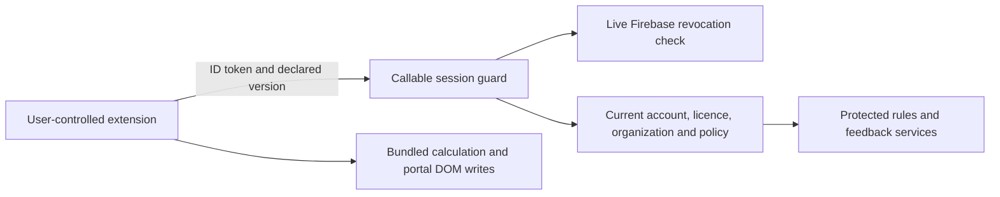

# Licensing security assessment and remediation

Reviewed November 14, 2026 against main after PR #51 (`a6fd5db`).
Scope: the owner's reported modified-package bypass and continued use after
revocation in old versions. The colleague's actual package and activity were not
available for forensic verification. The findings below come from source review,
controlled regressions and isolated acceptance tests; they do not assert that a
particular person performed a particular act.

## Root cause and trust boundary

Authentication and licensing are not exclusively client-side. Firebase Auth,
server-owned account/licence documents, administrator authorization, payment
activation, security rules and rate limits already exist. However, the valuable
bundled calculations and portal writes run locally. A user who controls an
unpacked extension also controls its gate checks, storage, network stubs and
writer. Local registration UI cannot establish an enforceable licensing boundary
for those offline capabilities.

The server controls the hosted-services path. The local path remains modifiable.
Removing UI checks cannot manufacture a valid server identity or entitlement, but
it can expose calculations whose complete implementation is already distributed.
No embedded secret, checksum or client self-report can reverse that fact.

## Code-level findings

| Finding | Evidence before remediation | Correction / residual limitation |
| --- | --- | --- |
| Local gate removal exposes bundled functionality | `content.js` has `evaluateLicenceGate` and `refreshProcessingRules`; `claim-core.js`, `audit-core.js`, generated rules and browser evaluator contain the calculations. Bypassing the local gate and fresh-check path leaves enough code to calculate/write locally. | Existing local copies cannot be remotely made unmodifiable. See the separate server-calculation proposal. No cracked package is produced by this review. |
| Rule download omitted full entitlement checks | `getActiveProcessingRules` checked an active profile and explicit deactivation, but omitted complete individual/organization expiry, missing licences, maintenance and minimum-version decisions. Skipping `verifyLicence` could reach the service directly, including its unchanged-version response. | Rule download now uses the same live entitlement decision as licence verification, before cache shortcuts or rule disclosure. Protected access requires an active term; a grace display state does not grant rule access. |
| Authenticated callable requests did not consistently check revoked sessions | Ordinary callable token validation was used. The monitor already called `verifyIdToken(token, true)`, while other callables did not. A still-unexpired ID token could outlive refresh-token revocation. | A shared callable wrapper performs the live revoked/disabled/deleted-user check before every authenticated handler and uses the verified identity. Invalid sessions deny; Auth lookup failures fail closed. |
| Outage handling reused cached authority | `background.js` retained successful licence flags for up to one hour on transport failure. `content.js` allowed some bundled processing after failed rule refresh. | Both new licence and rule-verification failures deny new Preview/Apply; cached rules/authority are cleared. Undo and recovery remain available. This changes outage behavior deliberately. |
| Local successful decisions had no short display deadline | Local flags could remain usable without a bounded decision deadline. | Active server decisions now have a maximum five-minute deadline, capped by licence and ID-token expiry. Updated clients also cap successful states and refresh on a five-minute alarm. Critical actions continue to request fresh checks. This is a bounded client decision, not a signed bearer capability and not trusted by the server. |
| Feedback accepted active profiles without the full service gate | `submitProcessingRuleFeedback` did not require current paid/organization entitlement or a supported version. | It now uses the shared entitlement gate. Its request includes `extensionVersion`; updated background code supplies it. Missing legacy fields deny instead of bypassing the policy. |
| Client version is self-reported | The request supplies `extensionVersion`. | The minimum is now checked at protected services as well as licence verification. It blocks honest unsupported clients; a version string is not binary attestation. A spoofed newer version never supplies a missing/revoked licence. |

The key implementation is in [Functions](../functions/index.js),
[background state management](../background.js) and
[claim gates](../content.js). Existing Firestore rules deny direct writes to
profiles/licences and all direct access to central-rule collections. No rule,
dependency, permission, minimum-version setting or production record is changed.

## Session, revocation and outage contract

- Every authenticated callable checks the live Auth session. Account suspension,
  rejection, role changes and deletion already revoke refresh tokens in the
  corresponding administrator operations. Those revocations now affect existing
  ID tokens on the next callable request, including older clients.
- Licence deactivation is distinct from suspending the Auth account. It denies
  protected rule/feedback access on the next request even with a valid token;
  account/onboarding support remains a separate service. Reactivating an account
  does not erase an independently inactive user licence.
- Each protected request reloads current account, payment/activation, effective
  organization licence, expiry and deployment policy. No server grant is derived
  from client storage, a previous verification response or `knownVersionId`.
- Active display decisions expire within five minutes, the paid term and token
  lifetime. The Firebase ID token retains its provider-defined lifetime; the
  response does not issue a new five-minute authentication token. The server
  always repeats its checks and never accepts the display deadline as authority.
- Server unavailability blocks hosted access. Updated clients deny new processing
  on licence/rule verification failure while retaining restoration functions.
  There is no cached-authorization outage extension.
- Requests already in flight may finish across a revocation race. Already returned
  data and local computations cannot be recalled. Checks govern subsequent requests;
  they are not remote cancellation of browser code or erasure of downloaded rules.

Firebase documents that ordinary token verification does not check revocation;
the additional live check is intentional and adds an Auth lookup per authenticated
request. See [token verification](https://firebase.google.com/docs/auth/admin/verify-id-tokens)
and [session revocation](https://firebase.google.com/docs/auth/admin/manage-sessions).

## Abuse monitoring and distribution

Existing per-user transaction-backed quotas remain in force. New structured
`callable_rejected` events contain only authenticated UID/null and a controlled
error code. `licence_access_denied` contains UID and a controlled licence status.
Function labels/timestamps come from the logging platform. These events do not
include bearer/refresh tokens, passwords, request bodies, patient/claim data,
portal URLs, IP addresses or device fingerprints.

Operators can inspect Cloud Logging for these messages, group by function/UID/code,
and alert on sustained authorization failures or quota exhaustion. Alerts, log
retention and budgets require deployment-specific configuration; no production
alert or automated account suspension is created here. Failure counts are signals,
not proof of redistribution. We do not claim reliable install counts or automatic
detection of shared credentials.

Use the verified official distribution package and the normal Store process.
Store package integrity helps identify the official distribution, but developer
mode permits loading modified copies. An extension ID, manifest key, API key,
Origin header, SHA-256 comparison or obfuscated JavaScript is not independent
proof that an untrusted client is unmodified. Checksums remain useful for build
traceability and corruption detection.

The owner confirmed that MIT is intentional; package licensing is unchanged.
The [MIT text](https://opensource.org/license/mit) permits modification and
redistribution subject to its conditions. Modification/redistribution alone is
therefore not treated as evidence of an infringement in this assessment. Hosted
service access is controlled separately through authenticated entitlements.
This review makes no determination about a particular redistributed copy's terms.

## Legacy versions

| Version/client behavior | What the server can enforce |
| --- | --- |
| Old client calls current hosted endpoints | Fresh session, live entitlement, maintenance and configured minimum are enforced after backend deployment, without trusting its cached activation flag. |
| Old client avoids updates but still requests rules | Below-minimum declared versions are denied. A claimed newer version still needs a live entitled identity. There is no claim of version attestation. |
| Old client uses already downloaded rules or entirely local algorithms | The server cannot remotely disable or erase that functionality. An official update improves cooperative clients only. Managed workplace browser/device policy is an organizational option outside this code change. |
| Copied package has no identity/credentials | Hosted access is denied. Copying the code does not activate an account. |
| Copied package includes a valid user's credentials/token | It can act as that identity until expiry/revocation; copied credentials are not distinguishable merely from an installation ID. Revoke compromised sessions and investigate through authorized administration. |

Never raise the configured minimum until the compatible official extension is
available. Minimum-version enforcement is compatibility policy, not a substitute
for server-side authorization. Disabling a known user's licence protects hosted
services; stopping all historical offline forks is not achievable remotely.

## Abuse-scenario verification

| Requested scenario | Coverage / expected boundary |
| --- | --- |
| Remove registration checks | Direct backend tests reject unauthenticated requests and client-supplied authority flags; local-only functionality remains outside server control. |
| No activated licence | Missing, unpaid and inactive entitlements deny rule access before data/cache responses. |
| Revoke while running | The same existing token loses protected access after server-side licence deactivation. |
| Avoid extension update | Protected endpoints enforce current configuration on each request; the old-version regression checks the unchanged-version shortcut too. |
| Licence expires | Expired/missing individual and organization terms deny protected access. Organization renewal remains authoritative over stale member expiry. |
| Copy package to another computer | Package-only requests have no server identity; valid stolen credentials remain a session-security risk, with live revocation tested separately. |
| Forge local activation | Server ignores client storage/authority fields and uses server-owned documents. |
| Disconnect to avoid checks | Background regressions deny cached authority, and real Chrome verifies blocked processing with working offline Undo/recovery. |
| Unsupported legacy version | Minimum-version and maintenance gates are tested at the rule service itself. |
| Reuse expired/revoked token | Handler-level regressions cover expired, revoked, disabled, deleted and mismatched Auth identities; real emulators verify refresh-token revocation and disabled-user denial. |

Tests are in [licensed-service regressions](../functions/test/licensed-services.test.js),
[background races/outages](../tests/auth-race.test.js),
[claim safety](../tests/claim-apply-safety.test.js) and the real Chrome/Firebase
acceptance scripts. Fifteen initial server regressions and two initial client
regressions failed against the original implementations. Unit stubs do not prove
production JWT signature verification; Firebase Admin SDK owns that boundary and
the emulator deliberately differs from production token signing.

## Prioritized rollout and next architecture

Local verification passed under Node 22 and Java 21: 313 root tests, 69 Functions
tests, ESLint and matrix/syntax/secret checks; standard/investigation/companion
Chrome smoke; actual extension and hosted-dashboard acceptance; all 6 Firestore
rules tests; and the complete signup/licence/governance/monitor emulator lifecycle.
The added real-emulator security sequence passed token revocation and disabled
Auth-user checks with the production handlers. The sponsored lifecycle now
explicitly checks that a revoked old token stays rejected after account
reactivation and signs in again before checking its independently inactive licence.

Browser fixtures now supply a healthy, stable initial rule identity for ordinary
safety assertions and separately assert outage denial. An earlier fixture relied
on transport fallback before acknowledgement checking; the new fail-closed policy
correctly rejected it earlier. These were acceptance-fixture changes, not removal
of acknowledgement, stale-value, Apply or Undo assertions.

1. Independently review and merge the security PR. Deploy the reviewed Functions
   to the explicitly selected project so **all** authenticated callable wrappers
   are updated. Deploying only rule download would leave other handlers on their
   previous session behavior. Keep existing configuration/versions unchanged.
2. Recheck server-side session/entitlement denials with authorized synthetic
   accounts. Use existing administrator controls to revoke identified compromised
   accounts/sessions if the owner requests it. No production account was changed.
3. Prepare a new extension patch release after merge, run all release gates and
   publish through the normal review process. The old 1.12.1 candidate checksum
   does not describe these new packaged files. No version bump or candidate ZIP
   from that earlier release is reused as security-release evidence.
4. Verify public availability before enforcing a new minimum. Notify affected
   users about fresh sign-in after revoked sessions and the fail-closed outage
   behavior. Configure monitoring/alerts and review false positives.
5. Implement the separately requested [server-calculation proposal](SERVER_CALCULATION_PROPOSAL.md)
   after the input/privacy/rollout decisions are reviewed. That migration is what
   reduces the value of future offline copies by keeping valuable logic on the
   server. This hardening PR does not move claim data into the cloud.

No deployment, release publication, live incident investigation, account mutation,
privacy-policy expansion or change to MIT licensing is performed by this PR.
